<div align="center">


# Antirion

**The open-source AI gateway: one Rust binary between your apps and every model provider.**

Route, meter, protect and observe every model call your company makes, from a single binary
with the admin console built in.

[](https://github.com/eliasbiondo/antirion/actions/workflows/pr.yml)
[](LICENSE)
[](rust-toolchain.toml)

[Getting started](#getting-started) ·
[Features](#features) ·
[Architecture](#architecture) ·
[Performance](#performance) ·
[Deploy](#deploy) ·
[Docs](#documentation)

</div>

<p align="center">
  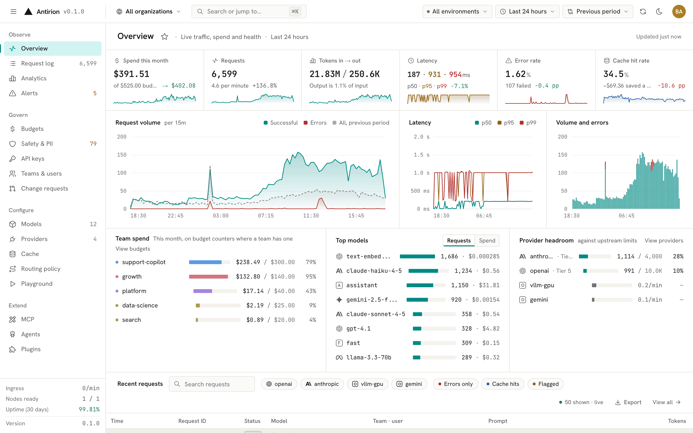
</p>

## Why Antirion

- **One binary, console included.** The gateway, the Admin API and the web console ship as a
  single Rust binary (or a distroless image). No sidecars, no separate UI deployment, no runtime
  to install.
- **Every major provider behind one API.** OpenAI, Azure OpenAI, Anthropic, Amazon Bedrock,
  Google Vertex AI, Gemini, Mistral, Cohere, Groq, Together, Fireworks, DeepSeek, xAI, Cerebras,
  DeepInfra, Perplexity, and any OpenAI- or Anthropic-compatible server such as vLLM. Clients
  speak OpenAI, Anthropic, Gemini or Bedrock; Antirion translates between them.
- **Routing that keeps you up.** Fallback chains, weighted splits, least cost, least latency,
  least busy, tiers, content classifiers, retries, hedging and circuit breakers, decided per
  request and recorded in the request log.
- **Spend under control.** Rate limits and budgets in dollars or tokens on the organization,
  team, project and key, with prices per Model, a cost ledger and alerts before a budget runs
  out.
- **Safety at the edge.** Guardrails for PII, secrets, keywords, regexes, JSON schemas, tool
  permissions, topics, moderation, model-based judges and partner services that catch prompt
  injection, on requests, responses and streams, with redaction that keeps the format.
- **Ready for production.** Exact and semantic caching, MCP and agent gateways, SSO with OIDC,
  SAML and SCIM, an audit log with change requests, and a standalone node or a cluster on
  PostgreSQL and Valkey.

## Features

<table>
  <tr>
    <td width="50%" valign="top">
      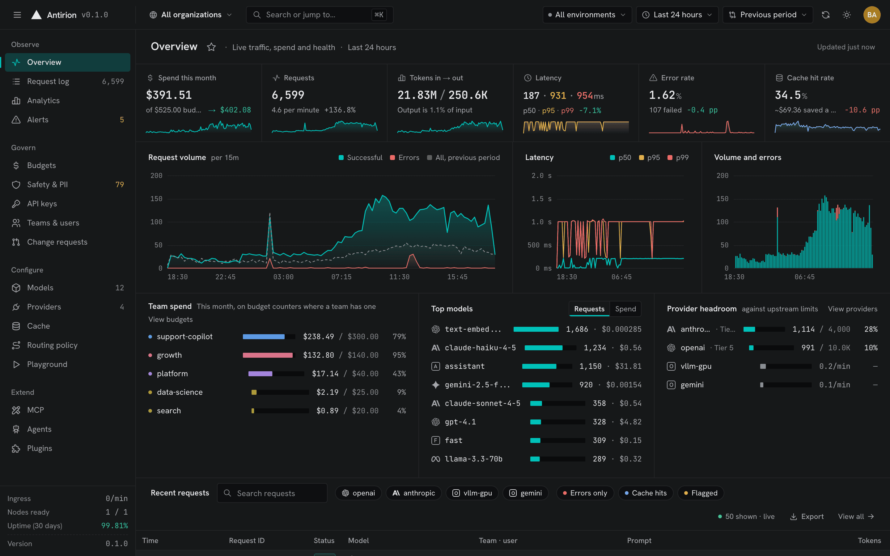<br>
      <b>Overview.</b> Spend, volume, latency, errors and cache hits at a glance, against the
      previous period.
    </td>
    <td width="50%" valign="top">
      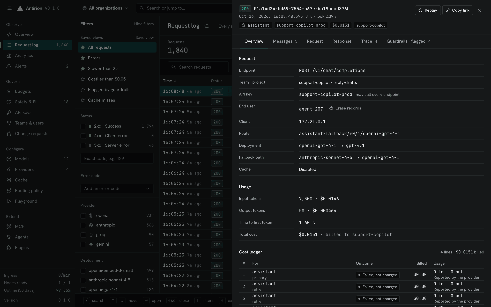<br>
      <b>Request log.</b> Every request with its route, attempts, tokens, cost, guardrails and,
      when you turn it on, its content.
    </td>
  </tr>
  <tr>
    <td width="50%" valign="top">
      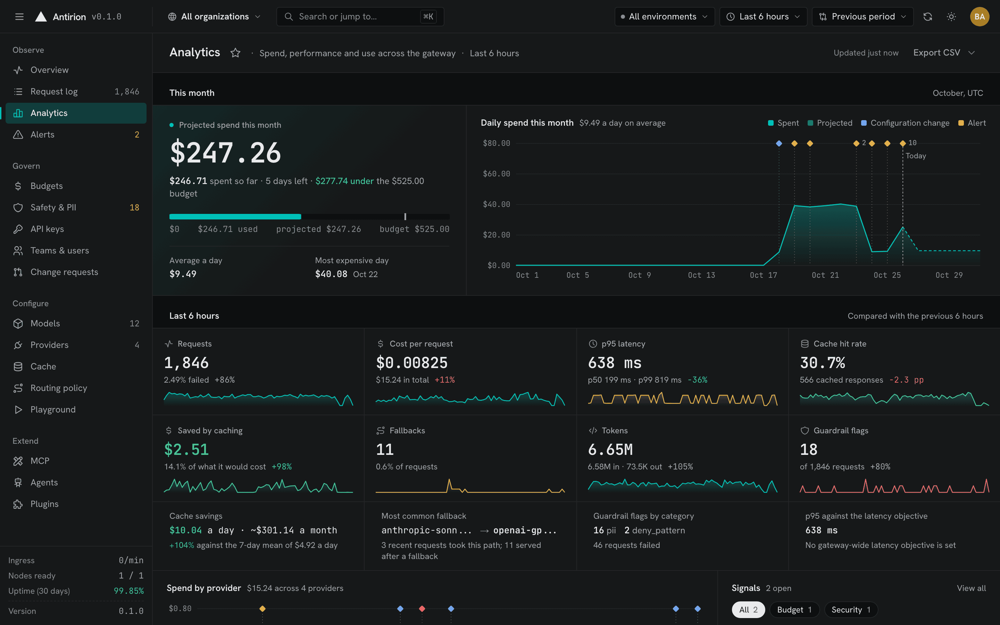<br>
      <b>Analytics.</b> Spend for the month and its projection, and every metric against the
      previous period, by Model, provider, team, key and person.
    </td>
    <td width="50%" valign="top">
      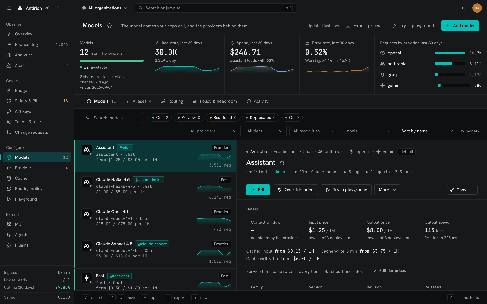<br>
      <b>Models.</b> The names your apps call, with tiers, aliases, prices and the deployments
      behind them.
    </td>
  </tr>
  <tr>
    <td width="50%" valign="top">
      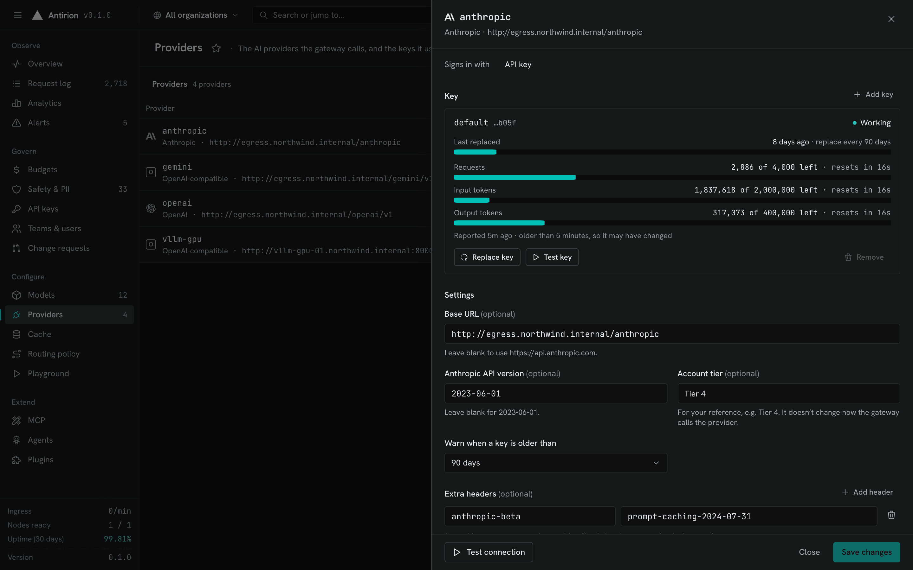<br>
      <b>Providers.</b> Each provider's keys with their rate-limit headroom, connection
      tests and settings.
    </td>
    <td width="50%" valign="top">
      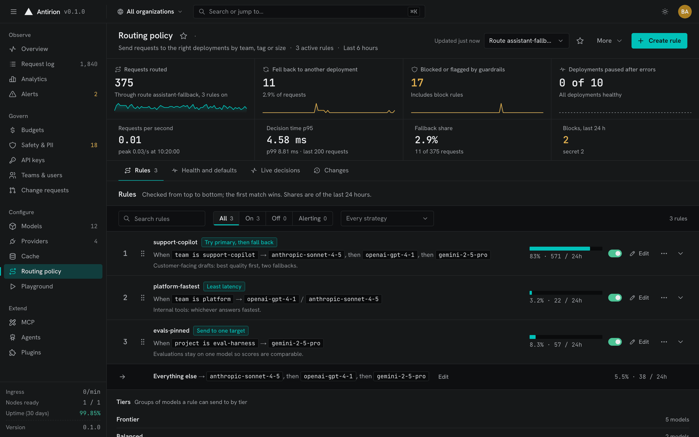<br>
      <b>Routing policy.</b> Rules by team, project or tag, each with its strategy and share
      of traffic, ahead of a default fallback.
    </td>
  </tr>
  <tr>
    <td width="50%" valign="top">
      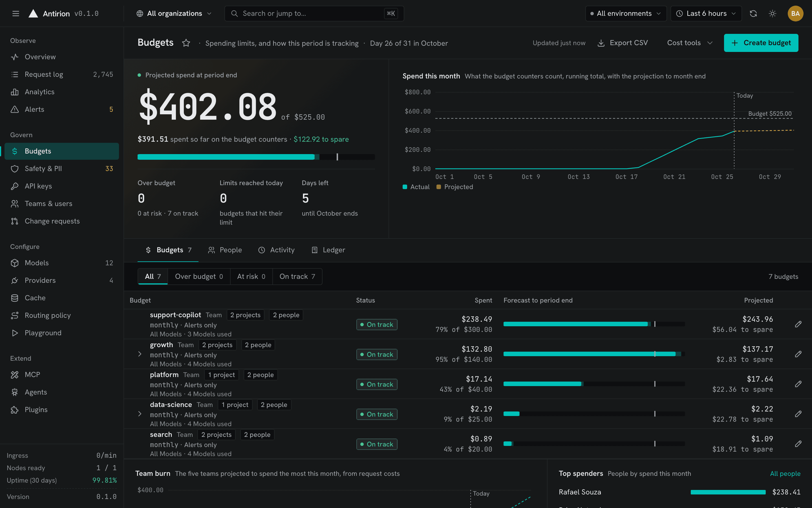<br>
      <b>Budgets.</b> Limits per organization, team, project and key, with projections and the
      ledger behind every number.
    </td>
    <td width="50%" valign="top">
      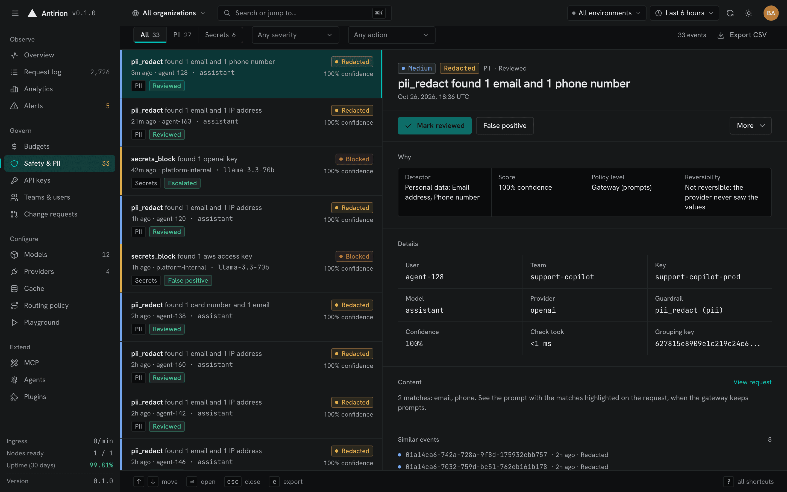<br>
      <b>Safety &amp; PII.</b> What the guardrails caught, redacted or blocked, and where it came
      from.
    </td>
  </tr>
  <tr>
    <td width="50%" valign="top">
      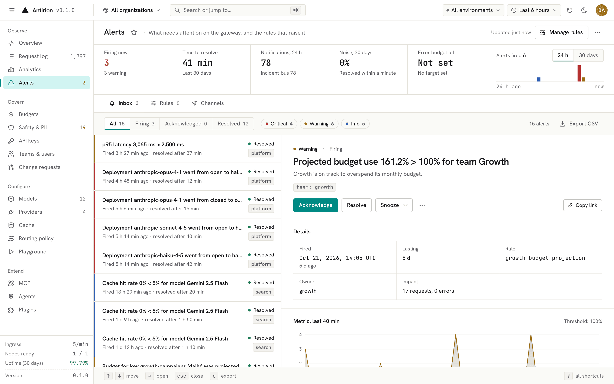<br>
      <b>Alerts.</b> Metric and event rules, notification channels, timelines and objectives.
    </td>
    <td width="50%" valign="top">
      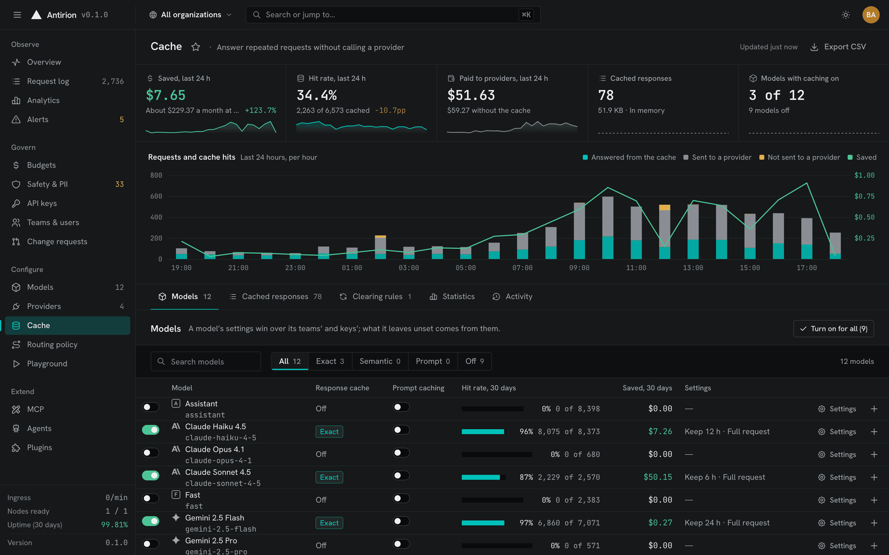<br>
      <b>Cache.</b> Exact and semantic caching per Model, team or key, with hit rates, savings
      and clearing rules.
    </td>
  </tr>
</table>

### Routing and resilience

- Route trees built from `fallback`, `weighted` (smooth weighted round robin, random or Thompson
  sampling for experiments), `least_cost`, `least_latency`, `least_busy`, `conditional`,
  `classifier` and `cost_quality` nodes, plus model tiers (`frontier`, `balanced`, `fast`,
  `specialized`) that pick among the Models of a tier.
- Retries with backoff, a cross-request retry budget, request hedging, circuit breakers with
  half-open probes, cooldowns per key and deployment, and response predicates that reject a bad
  2xx answer.
- Session and prompt-prefix affinity, shadow traffic to a mirror, and pool scheduling for
  self-hosted servers that reads their load and prefix and LoRA adapter state.
- Translation between dialects: an OpenAI Chat client can call a Claude deployment, an Anthropic
  Messages client can call GPT, and streams are translated event by event.
- `POST /routes/{name}:simulate` and the console's simulator show which deployment a request would
  reach, and why.

### Cost control

- Rate limits on requests, tokens or concurrency (GCRA or sliding window) and budgets in dollars or
  tokens, daily to yearly, calendar or rolling, soft, hard or held for approval, at the gateway,
  organization, team, project, key and Model levels.
- Prices per deployment with input, output, cached, reasoning, audio and image rates, tiered and
  batch prices, and a bundled catalog of list prices for the models you add.
- A spend ledger with one line per charge, re-costing of a past window under new prices, and
  overage requests that an admin approves or denies.
- Budget projections, run-out dates and cost alerts, plus cache hits that can be served even when a
  budget is spent.

### Safety and data protection

- Guardrails: `pii` (email, phone, credit card, SSN, IBAN, IP address and more), `secrets` (provider
  keys, cloud credentials, tokens, private keys), `keywords`, `regex`, `json_schema`,
  `tool_permission`, `length`, `moderation`, `llm_judge`, `classifier`, `topic`, `template` and
  `webhook` checks, plus partner safety services for content and prompt-injection detection.
- Actions `block`, `redact` (with format-preserving masks), `flag` or `divert`, on the input, the
  output and streams, blocking, asynchronous or in parallel with the call.
- A safety event for every hit, reviewable in the console, with statistics by category, guardrail,
  key and team.
- Request content is logged only when a policy turns it on, with PII masked, hashed or dropped, and
  a zero-data-retention mode per level.

### Observability

- A request log with the route taken, every attempt and why it failed, tokens, cost, cache status,
  guardrail verdicts and timing, searchable with facets and saved views.
- Analytics by Model, provider, deployment, team, key and person, with comparisons against a
  previous period.
- Prometheus and OpenMetrics metrics on the admin listener, OTLP traces, logs and metrics, and HTTP
  log sinks.
- Alert rules on latency, error and fallback rates, utilization, spend, budget projections,
  guardrail events and cache hit rate, or on events, sent to Slack, PagerDuty, email, webhooks or
  browser push; service-level objectives with daily availability.

### Identity and access

- Virtual keys per project with allowed Models, providers, endpoints, IP ranges and expiry; JWT
  keys checked against your issuers; bring-your-own provider keys.
- Organizations, teams, projects and users with built-in and custom roles bound per scope.
- Console sign-in with local accounts (TOTP and WebAuthn second factors), OIDC, SAML and GitHub
  single sign-on, and SCIM provisioning of users and groups.
- An audit log of every change, streamed to HTTP audit sinks, and change control: a change
  request, or a second person's approval, for the changes you choose.

### Operations

- The whole configuration is one document: a YAML file, the Admin API or the console, validated
  against a published JSON Schema, with numbered generations, diffs and rollback.
- Standalone with an embedded store, or a cluster of nodes on PostgreSQL and Valkey that share
  counters, budgets, cache and health.
- Graceful drain, readiness and liveness probes, and secrets read from the environment, files,
  HashiCorp Vault, AWS Secrets Manager, Google Secret Manager or Azure Key Vault, sealed at rest.
- A distroless image that runs as a non-root user on a read-only root filesystem, release binaries
  with an SBOM, Sigstore signatures and SLSA provenance, and a Helm chart.

### Extensibility

- An MCP gateway: remote servers over Streamable HTTP or HTTP+SSE, local `stdio` servers and OpenAPI
  documents served as tools, behind one endpoint with namespacing, grants, tool approval, limits and
  guardrails.
- An A2A proxy for agents, with their cards, behind the same keys, limits and request log as model
  traffic.
- Plugins: hooks at each stage of a request, as signed webhooks or WebAssembly components, with
  JSON Patch edits.
- The Admin API is described by an OpenAPI document (`openapi/admin-api.yaml`); everything the
  console does goes through it.

## Getting started

### Prerequisites

- **Docker** with Compose v2.24 or later, to run the published Compose setup; or
- **Rust** (the toolchain in [`rust-toolchain.toml`](rust-toolchain.toml)), **Node 22+** and
  **pnpm**, to build from source (see [From source](#from-source)).

### 1. Start the gateway

```bash
git clone https://github.com/eliasbiondo/antirion.git
cd antirion
cp .env.example .env
# Put a bootstrap token and an encryption key in .env:
sed -i.bak "s|^ANTIRION_BOOTSTRAP_TOKEN=.*|ANTIRION_BOOTSTRAP_TOKEN=$(openssl rand -hex 24)|; s|^ANTIRION_ENCRYPTION_KEY=.*|ANTIRION_ENCRYPTION_KEY=$(openssl rand -base64 32)|" .env && rm .env.bak
docker compose --profile mock up -d    # the first run builds the images: 10 to 20 minutes
```

This starts one gateway with its data in a Docker volume, Mailpit to catch the email it sends, and
a mock upstream that answers like OpenAI and Anthropic (the `mock` profile). The ports are published
on 127.0.0.1 only:

| Port | What                                                       |
| ---- | ---------------------------------------------------------- |
| 8080 | the data plane: the `/v1` API your apps call               |
| 8081 | the admin plane: the Admin API and the console at `/ui/`   |
| 8025 | Mailpit: every email the gateway sends, in a web interface |

`docker compose ps` shows the gateway as `healthy` once it is ready.

### 2. Sign in

Open <http://localhost:8081/ui/> and paste `ANTIRION_BOOTSTRAP_TOKEN` from `.env` into **Admin
token**. From there you can invite your team, so everyone signs in with their own account.

### 3. Add a provider

**Providers → Add provider.** To try it without a real key, choose **OpenAI-compatible**, name it
`mock`, sign in with **No authentication** and use the base URL `http://mock-upstream:19401/v1`.
For a real provider, choose it and paste its API key.

**Test** the connection: the gateway asks the provider for its models, and the provider can only be
saved once the test passes, so a wrong URL or key shows here. Then **Add provider**.

### 4. Add a Model

**Models → Add model.** Pick the provider, then the model from the list the provider returned. A
real provider's list shows each model's list price, which applies when you leave the price fields
blank. Give it the name your apps will send, such as `chat`, and **Add model**. The mock's models
have no list price, so set prices such as `0.15` and `0.60` to see its requests cost something.

### 5. Create a key and send a request

**API keys → Create key**, name it `my-app` (the project `default` is already chosen), then
**Copy**: the key is shown once.

```bash
export ANTIRION_API_KEY=sk-antirion-…   # the key you copied
curl -s http://localhost:8080/v1/chat/completions \
  -H "Authorization: Bearer $ANTIRION_API_KEY" -H 'Content-Type: application/json' \
  -d '{"model": "chat", "messages": [{"role": "user", "content": "Hello"}]}'
```

Any OpenAI SDK works the same way: point its base URL at `http://localhost:8080/v1`. Add
`"stream": true` for a streamed answer.

### 6. See it in the Request log

**Request log** lists the request with its status, Model, key, tokens, latency and cost. Select it
for the details, from the route taken to the cost ledger. The **Playground** sends requests from
the console.

Invitations, password resets and email alerts go to Mailpit at <http://localhost:8025>, so nothing
leaves your machine until you configure a real SMTP server.

[docs/getting-started.md](docs/getting-started.md) goes further: other ports and host names, test
mode, real email, the Compose cluster, Kubernetes with Helm and running from source.

## Architecture

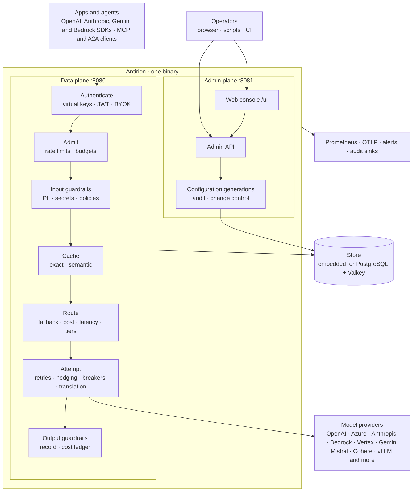

- **The data plane** serves the model APIs (`/v1/chat/completions`, `/v1/responses`,
  `/v1/messages`, `/v1/embeddings`, Gemini and Bedrock paths, Files, Batches, Realtime, MCP and A2A).
  Each request is authenticated, admitted against its limits and budgets, checked by the input
  guardrails, looked up in the cache, routed, sent with retries and checked again on the way out.
  Its record (route, attempts, tokens, cost, verdicts) is written once it settles.
- **The admin plane** serves the Admin API and the console. Configuration changes are validated,
  committed as a new generation and applied to every node without a restart.
- **The store** keeps configuration, keys, the request log, the spend ledger and the audit log. A
  standalone node embeds it; a cluster shares PostgreSQL for state and Valkey for counters,
  budgets and the cache.

The code is a Rust workspace of layered crates, from parsing and the wire formats up to the
pipeline, the Admin API and the binary; [docs/development.md](docs/development.md) has the map.

## Performance

A reference benchmark compares Antirion with Bifrost and LiteLLM on identical, dedicated hardware.

- **Hardware.** Dedicated AWS c7i instances in one cluster placement group: the gateway on a
  c7i.xlarge, the load generator and the upstream each on their own larger c7i, so the network
  between them is short and steady and only the gateway is under test.
- **Upstream.** A mock upstream with a fixed, scripted latency, so the time it takes is known and
  everything above it is the gateway's.
- **Load.** An open-loop generator sends each request at its scheduled time, whatever the gateway's
  speed, and measures latency from that time, so a slow gateway cannot hide its queueing.
- **What is measured.** Gateway overhead (latency above the upstream's scripted delay) at the
  median and the tail, errors, CPU time per request, and memory under load and at idle.

<!-- BENCH: results pending. This whole block stays hidden until the reference run is in.
To publish: replace every [BENCH: …] placeholder below with its value, add the two SVG charts at
docs/images/bench-overhead.svg and docs/images/bench-resources.svg, then delete this opening comment
line and the closing "BENCH: end of results" line. (HTML comments cannot nest, so the placeholders
inside this block are bracketed tokens; search for "BENCH:" to find them all.)

[BENCH: headline sentence, e.g. "At 5,000 requests per second, Antirion adds X ms at p99 and uses Y× less CPU per request."]

**Simple chat at 5,000 requests per second on a dedicated c7i.xlarge**

| Gateway         | Overhead p50                | Overhead p99                | Errors                       | CPU per request             | Memory (RSS peak)           | Idle memory                  |
| --------------- | --------------------------- | --------------------------- | ---------------------------- | --------------------------- | --------------------------- | ---------------------------- |
| **Antirion**    | [BENCH: antirion p50]       | [BENCH: antirion p99]       | [BENCH: antirion errors]     | [BENCH: antirion cpu/req]   | [BENCH: antirion rss peak]  | [BENCH: antirion idle rss]   |
| Bifrost 2.2.4   | [BENCH: bifrost p50]        | [BENCH: bifrost p99]        | [BENCH: bifrost errors]      | [BENCH: bifrost cpu/req]    | [BENCH: bifrost rss peak]   | [BENCH: bifrost idle rss]    |
| LiteLLM 1.103.1 | [BENCH: litellm p50]        | [BENCH: litellm p99]        | [BENCH: litellm errors]      | [BENCH: litellm cpu/req]    | [BENCH: litellm rss peak]   | [BENCH: litellm idle rss]    |

<p align="center">
  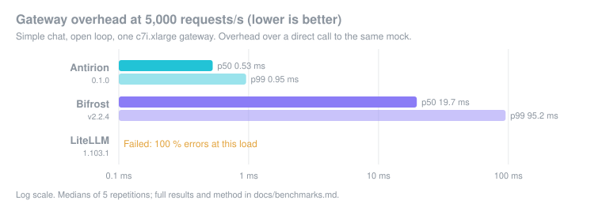
  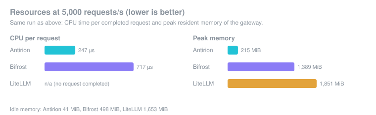
</p>

**More scenarios**

| Scenario                                  | Antirion                     | Bifrost 2.2.4                | LiteLLM 1.103.1              |
| ----------------------------------------- | ---------------------------- | ---------------------------- | ---------------------------- |
| Simple chat at 1,000 RPS, p99 overhead    | [BENCH: 1k rps antirion]     | [BENCH: 1k rps bifrost]      | [BENCH: 1k rps litellm]      |
| Larger request body, p99 overhead         | [BENCH: large body antirion] | [BENCH: large body bifrost]  | [BENCH: large body litellm]  |
| Streaming, time to first token p99        | [BENCH: ttft antirion]       | [BENCH: ttft bifrost]        | [BENCH: ttft litellm]        |
| Throughput over 64 connections            | [BENCH: 64 conn antirion]    | [BENCH: 64 conn bifrost]     | [BENCH: 64 conn litellm]     |
| Rejections at 20,000 RPS                  | [BENCH: 20k rps antirion]    | [BENCH: 20k rps bifrost]     | [BENCH: 20k rps litellm]     |

BENCH: end of results -->

> [!NOTE]
> Results from the reference run on c7i instances will be published here.

The harness, its mock upstream and load generator live in `bench/`. **Reproduce it:**
[docs/benchmarks.md](docs/benchmarks.md) has the topology, the scenarios and the steps to run the
same benchmark on your own instances.

## Deploy

| Where                  | How                                                                                                                         |
| ---------------------- | --------------------------------------------------------------------------------------------------------------------------- |
| **Docker Compose**     | `compose.yaml`: one standalone gateway with the embedded store, Mailpit and the optional mock upstream.                    |
| **A Compose cluster**  | `compose.cluster.yaml`: two gateways on PostgreSQL and Valkey behind a proxy, on the same ports.                            |
| **Kubernetes**         | The Helm chart in `deploy/helm/antirion`: standalone with a persistent volume, or a cluster with your PostgreSQL and Valkey. |
| **From source**        | `cargo build --release -p antirion`, with the console embedded from `console/out`.                                          |

### Docker Compose

```bash
docker compose --profile mock up -d                          # standalone
docker compose -f compose.cluster.yaml --profile mock up -d  # a cluster: stop the standalone one first
```

The cluster needs both keys in `.env`, with a bootstrap token of at least 32 characters.

### Helm

```bash
helm install antirion deploy/helm/antirion \
  --set image.repository=<your registry>/antirion --set image.tag=<tag> \
  --set console.publicOrigin=https://antirion.example.com
```

`mode: standalone` (the default) runs one replica with the embedded store on a persistent volume;
`mode: cluster` runs several replicas on PostgreSQL and Valkey, bundled for trying it out or your
own for production. The chart generates the bootstrap token and the encryption key once and keeps
them across upgrades. `values.yaml` documents every value.

### From source

```bash
(cd console && pnpm install --frozen-lockfile && pnpm build)   # optional: without it the console is a placeholder page
cargo build --release -p antirion
./target/release/antirion serve --config <file>
```

The binary also validates a configuration offline (`antirion validate -f <file>`), prints its
schema (`antirion schema`) and checks a node's health (`antirion healthcheck`).
`docker/Dockerfile` builds the image: the console and the binary in a distroless image that runs as
UID 65532 with a read-only root filesystem.

## Documentation

- [Getting started](docs/getting-started.md): Compose, the first request, ports and host names,
  test mode, email, the Compose cluster, Kubernetes with Helm and running from source.
- [Development guide](docs/development.md): the crate map, a request's path through the data plane,
  where each concern lives and the conventions of the code.
- [Console](console/README.md): the console's commands, layout and screens.
- [Admin API](openapi/admin-api.yaml): the OpenAPI document of every admin operation, also
  served by the gateway at `/admin/v1/openapi.json` and linked from the console's account menu.
- [Configuration schema](schema/antirion-config.schema.json): the JSON Schema of the configuration
  document (`antirion schema` prints it).

## Contributing

Contributions are welcome. [CONTRIBUTING.md](CONTRIBUTING.md) covers the development setup (the
pinned Rust toolchain, pnpm, the gateway and the console in dev), the checks every pull request must
pass, Conventional Commits and the pull request flow. [docs/development.md](docs/development.md) is
the place to start reading the code.

## Security

Please report vulnerabilities privately, as described in [SECURITY.md](SECURITY.md), not in public
issues.

## License

Copyright 2026 Elias Biondo. Antirion is licensed under the [Apache License, Version 2.0](LICENSE);
see [NOTICE](NOTICE) for attributions.
